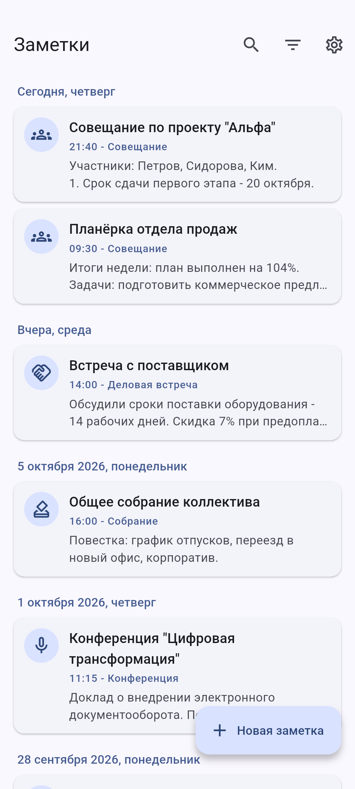
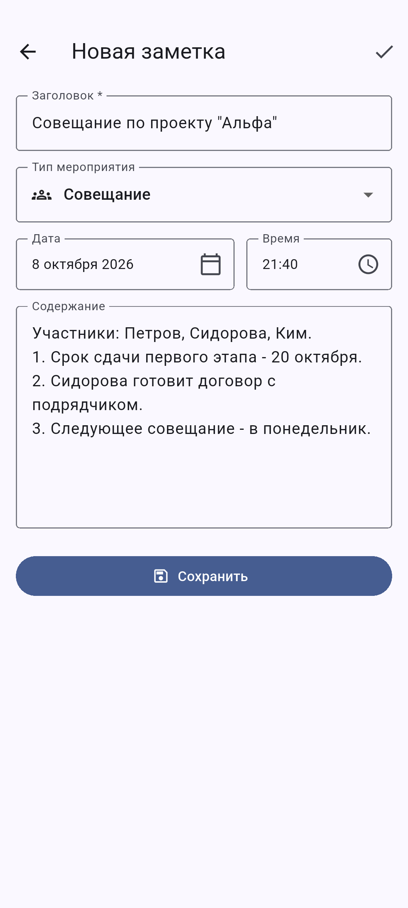
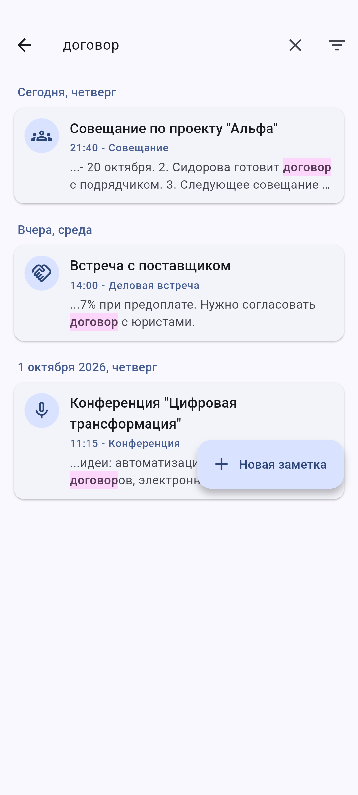
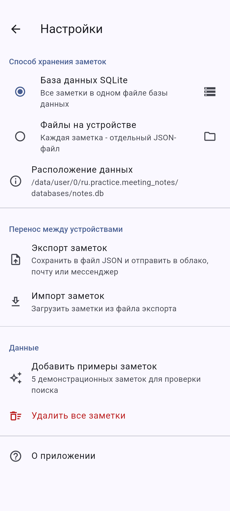

# Заметки для совещаний

Мобильное приложение (Flutter, Android/iOS) для ведения заметок во время
совещаний, собраний, конференций и деловых встреч. Кейс-задача № 4.

<p>




</p>

## Возможности

| Функция | Как реализовано |
|---|---|
| Создание заметки | Заголовок, тип мероприятия, дата, время, содержание; проверка обязательного заголовка |
| Редактирование | Изменение любых полей; предупреждение о несохранённых изменениях |
| Удаление | Смахиванием влево в списке или кнопкой на экране заметки; подтверждение и кнопка "Отменить" |
| Поиск | По ключевым словам (без учёта регистра, с подсветкой совпадений), по периоду дат, интервалу времени и типу мероприятия; условия комбинируются |
| Хранение: SQLite | Локальная база `notes.db` (пакет `sqflite`) |
| Хранение: файлы | Каждая заметка - отдельный JSON-файл в папке приложения `notes/` |
| Перенос между устройствами | Экспорт всех заметок в JSON и отправка в Google Диск / почту / мессенджер; импорт файла на другом устройстве |

Способ хранения переключается в **Настройках**; при переключении можно перенести
существующие заметки в новое хранилище.

## Установка APK (Android)

1. Скачайте `meeting_notes-1.0.0.apk` со страницы **Releases** репозитория.
2. Откройте файл на телефоне и разрешите установку из этого источника.
3. Запустите приложение "Заметки".

Требуется Android 7.0 и новее.

## Запуск из исходников

```bash
flutter pub get
flutter run                 # на подключённом телефоне или эмуляторе
flutter test                # unit- и widget-тесты
flutter build apk --release # сборка APK
```

Сквозной сценарий на эмуляторе с автоматическими скриншотами:

```bash
flutter drive --driver=test_driver/integration_test.dart \
  --target=integration_test/screenshots_test.dart
```

## Структура проекта

```
lib/
  main.dart                    точка входа, тема, русская локализация
  models/note.dart             модель заметки и типы мероприятий
  models/note_query.dart       параметры поиска
  storage/note_repository.dart общий интерфейс хранилища
  storage/sqlite_repository.dart  хранение в SQLite
  storage/file_repository.dart    хранение в файлах JSON
  state/notes_provider.dart    состояние приложения, переключение хранилищ, экспорт/импорт
  screens/                     экраны: список, просмотр, редактирование, фильтры, настройки
  widgets/                     карточка заметки, подсветка совпадений, форматирование дат
test/                          тесты обоих хранилищ, поиска, экспорта/импорта и интерфейса
integration_test/              сквозной сценарий на устройстве
docs/                          скриншоты, пример файла экспорта
```

## Документация

- [Пример файла экспорта для проверки импорта](docs/notes_export_example.json)
